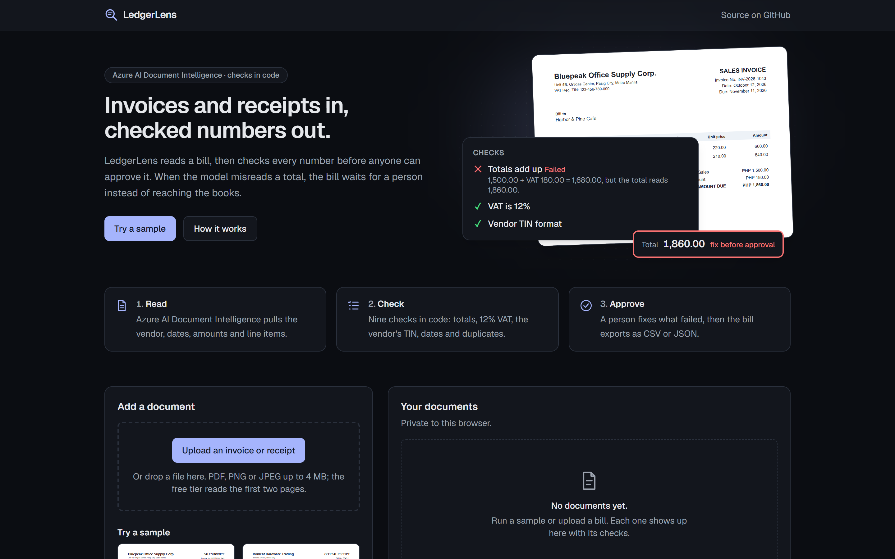
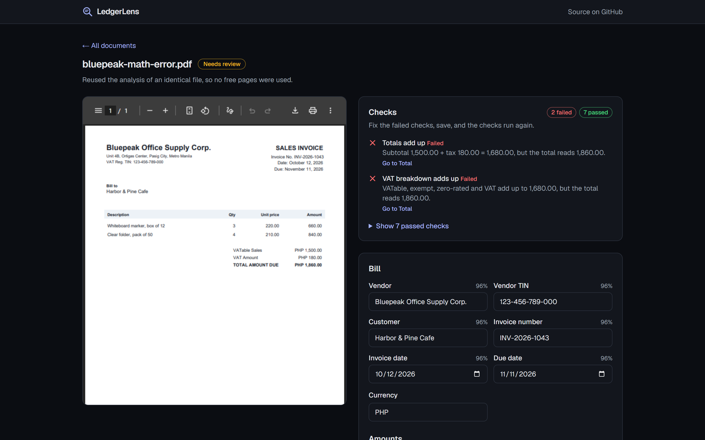
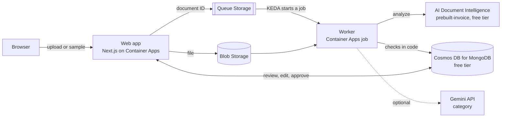

# LedgerLens

[](https://github.com/Zebbb01/ledgerlens/actions/workflows/ci.yml)

Invoices and receipts in, checked numbers out. LedgerLens reads a bill with **Azure AI Document
Intelligence**, then checks it in code: totals, line items, 12% Philippine VAT, dates, the vendor's TIN
and duplicates. A bill that fails a check cannot be approved until a person fixes it. Approved bills
export as CSV or JSON for the books.

**Live demo: https://ca-ledgerlens-iq777r.salmonriver-2ba7975b.southeastasia.azurecontainerapps.io**
(no sign-up; open a sample). The app scales to zero when idle, so the first visit takes about 30 seconds
to wake it, and the first document can take up to a minute while the worker starts.

It runs on Azure entirely within free tiers: a Next.js web app and a queue worker on **Azure Container
Apps**, files in **Blob Storage**, work handed over through **Queue Storage**, data in **Cosmos DB for
MongoDB**, all provisioned with **Terraform** and deployed by **GitHub Actions** over OpenID Connect.





## What it does

- **Reads** PDF, PNG and JPEG invoices and receipts with the `prebuilt-invoice` model, and the Philippine
  VAT breakdown (VATable, VAT-exempt, zero-rated sales, VAT amount) from the page text.
- **Checks** every result in code and **fails closed**: a failed check blocks approval, a low-confidence
  field asks for a look. Nothing the model reads is trusted unchecked.
- **Lets a person correct** any field. Corrections are kept in an edit history and the checks run again.
- **Spends the free allowance carefully**: an identical file reuses its earlier analysis, so the samples
  cost nothing after their first run, and monthly and daily caps keep usage under the free tier.
- **Suggests an expense category** from a fixed chart of accounts with an LLM (optional, the Gemini
  API's free tier). Only the vendor name and item descriptions go into the prompt.
- **Keeps each browser's documents private** through a per-browser workspace; every query is scoped to it.

## How it works



1. The web app sniffs the file type from its first bytes, stores the file in Blob Storage, saves a
   `queued` record and puts the document ID on the queue.
2. KEDA sees the message and starts a Container Apps job. The worker drains the queue and exits, so it
   costs nothing while idle. Locally the same worker runs with `--watch`.
3. The worker looks for an earlier analysis of the same file (SHA-256). If there is none, it reserves
   pages from the monthly allowance and calls Document Intelligence, retrying when the free tier
   throttles (one request per second).
4. Code normalizes the result (money in integer cents from here on), runs the checks, and saves the
   invoice with its checks. The browser polls until the record leaves the queue.

## The checks

| Check | Rule | When it does not hold |
| --- | --- | --- |
| Required fields | Vendor, invoice date and total are present | Fails |
| Totals add up | Subtotal − discount + tax = total, within one centavo | Fails |
| Line items add up | Lines sum to the subtotal, or to the total for VAT-inclusive prices | Asks for a look |
| VAT is 12% | VAT = 12% of VATable sales, within two centavos | Fails |
| VAT breakdown adds up | VATable + exempt + zero-rated + VAT = total | Fails |
| Dates make sense | Invoice date not in the future; due date not before it | Fails |
| Vendor TIN format | Peso invoices show a TIN in the BIR format 000-000-000-000 | Fails; a missing TIN asks for a look |
| Not a duplicate | No other document in the workspace has this vendor and invoice number | Fails |
| Read confidence | Key fields read with at least 80% confidence | Asks for a look |

"Today" for the date check is taken on UTC+14, so no time zone sees a valid invoice dated today as being
in the future.

## Staying free

| Service | Free allowance | How LedgerLens stays inside it |
| --- | --- | --- |
| Container Apps (consumption) | 180,000 vCPU-seconds, 360,000 GiB-seconds and 2 million requests a month | Web app scales to zero, at most one 0.25 vCPU replica; the worker job runs only while the queue has messages |
| AI Document Intelligence F0 | 500 pages a month; first 2 pages and 4 MB per file; 1 request per second | 450-page monthly cap, 2 pages reserved per analysis, analyses reused by file hash, daily upload limits, 429 retries |
| Cosmos DB for MongoDB | Free tier: first 1000 RU/s and 25 GB, for the life of the account | One database sharing 400 RU/s; documents expire after 7 days |
| Blob and Queue Storage | 5 GB for 12 months on a free account | Files deleted after 7 days by a lifecycle rule; a few cents a year at most after that |
| Log Analytics | 5 GB of ingestion a month | Daily cap of 0.15 GB |
| GitHub Actions and Container Registry | Free for public repositories | |
| Gemini API (optional) | Free tier, rate-limited; Google may use free-tier prompts to improve its products | Off unless a key is set; only the vendor name and item descriptions are sent |

## Tech stack

| Part | Choice |
| --- | --- |
| Web app | Next.js 16 (App Router, route handlers), React 19, TypeScript, Tailwind CSS 4 |
| Worker | Plain Node.js running the same TypeScript files (native type stripping), same container image |
| Document AI | Azure AI Document Intelligence REST API, `prebuilt-invoice`, Microsoft Entra ID auth |
| Data | MongoDB driver against Cosmos DB for MongoDB; each collection sharded on the field its queries use |
| Files and queue | Azure Blob Storage and Queue Storage, managed identity (Azurite locally) |
| Infrastructure | Terraform (azurerm 4), Azure Container Apps with a KEDA `azure-queue` event-driven job |
| CI/CD | GitHub Actions: lint, typecheck, unit and end-to-end tests, Terraform validate, image build; deploy to GHCR and Container Apps over OpenID Connect |
| Tests | Vitest with an in-memory MongoDB, Playwright end to end against Azurite and a mock Document Intelligence server |

## Run it locally

You need Node.js 22.16 or later. No Azure account is needed: Azurite stands in for Blob and Queue
Storage, an in-memory MongoDB for Cosmos DB, and a mock server for Document Intelligence (it answers
for the sample files).

```bash
npm install
cp .env.example .env.local
npx azurite --silent --inMemoryPersistence --skipApiVersionCheck --loose   # terminal 1
npm run services                                                          # terminal 2: MongoDB, mock DI, worker
npm run dev                                                               # terminal 3: http://localhost:3200
```

To read your own documents locally, point `DI_ENDPOINT` at a real Document Intelligence resource and sign
in with `az login` (or set `DI_KEY` for a resource that allows keys).

## Tests

```bash
npm test           # unit tests: extraction, checks, edits, quota, Document Intelligence client, pipeline
npm run test:e2e   # Playwright: starts Azurite, MongoDB, the mock service, the worker and the app
```

The end-to-end tests cover a passing VAT invoice through approval and CSV export, a wrong total that
blocks approval until it is corrected, duplicate detection with analysis reuse, uploads, a refused file
type, a document the service cannot read, and that one browser cannot open another's documents.

**Accuracy.** The four sample documents are generated by `npm run samples` (all names are fictitious),
with answer keys in `samples/answers.json`; `npm run eval` scores a Document Intelligence resource
against them field by field. Against the live free-tier resource (`prebuilt-invoice`, November 2026),
**43 of 44 fields (97.7%)** came back right:

- The model missed the TIN printed as "VAT Reg. TIN: …" on both Bluepeak invoices, so LedgerLens now
  reads the seller's TIN from the page text when the model finds none (2/4 → 4/4).
- On the receipt it read the VAT-inclusive total as the subtotal. That is the one miss left, and it is
  why the checks exist: subtotal + VAT no longer equals the total, so "Totals add up" fails and the
  receipt cannot be approved until a person corrects the subtotal.

Four clean, generated documents are a smoke test, not a benchmark.

**A real invoice.** An SPX (Shopee logistics) shipping invoice from a real order, kept out of the
repository because it carries a name and an address, went through the same live resource. Before:
**8 of 11 fields**. The model took the "SPX EXPRESS" logo as the vendor, and the VAT checks never ran
because Shopee labels the breakdown "PH VAT STD sales" and plain "VAT". LedgerLens now prefers the
registered business name the model also returns ("SPX Philippines Inc.") and reads those labels. After:
**11 of 11**, every check passes, and only the invoice number, read at 54% confidence, is flagged for a
look.

## Security

- **No keys in configuration.** The app and worker use a managed identity for Storage and Document
  Intelligence; key access to Document Intelligence is switched off. GitHub Actions deploys through
  OpenID Connect, with no stored secret.
- **Workspace isolation.** Every database query carries the workspace ID from an HttpOnly cookie, and the
  end-to-end suite checks that another browser gets "Document not found".
- **Untrusted input.** File types come from magic bytes, not names. Edits are validated field by field on
  the server. CSV cells that start like a formula are prefixed so a spreadsheet will not run them.
- **Privacy.** Raw IP addresses are never stored (only a salted hash for the daily limit), and files and
  records expire after 7 days.

## Limits and next steps

- The free tier reads only the first two pages of a file. Receipts go through the invoice model; the
  `prebuilt-receipt` model would read thermal receipts better.
- There are no accounts yet: workspaces are per browser. Sign-in with roles, Stripe test-mode billing per
  page, and pushing approved bills to a QuickBooks or Xero sandbox are the next steps.
- Logs are structured JSON in Log Analytics; Application Insights tracing is not wired up yet.

Deployment steps are in [DEPLOYMENT.md](DEPLOYMENT.md).
